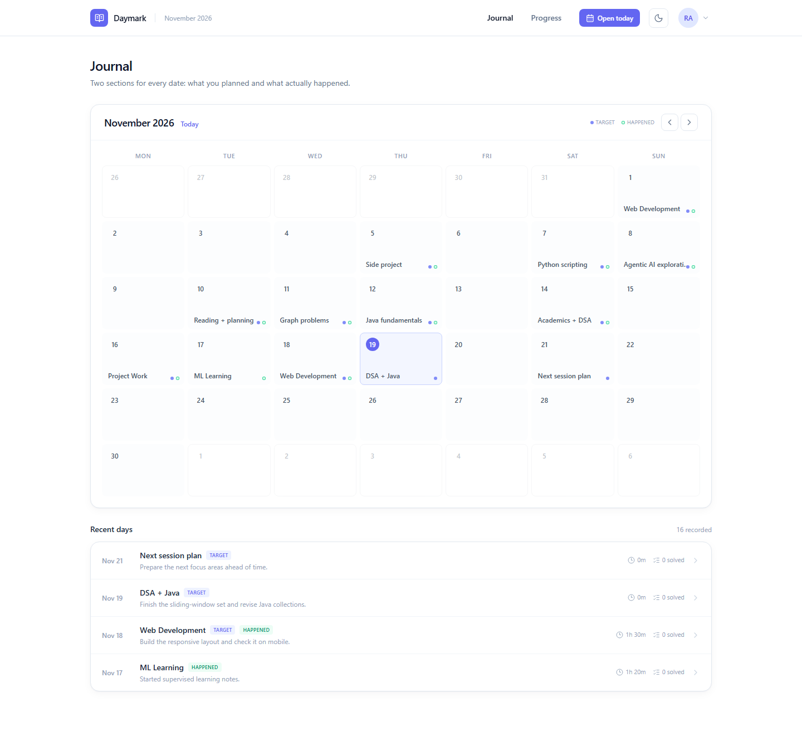
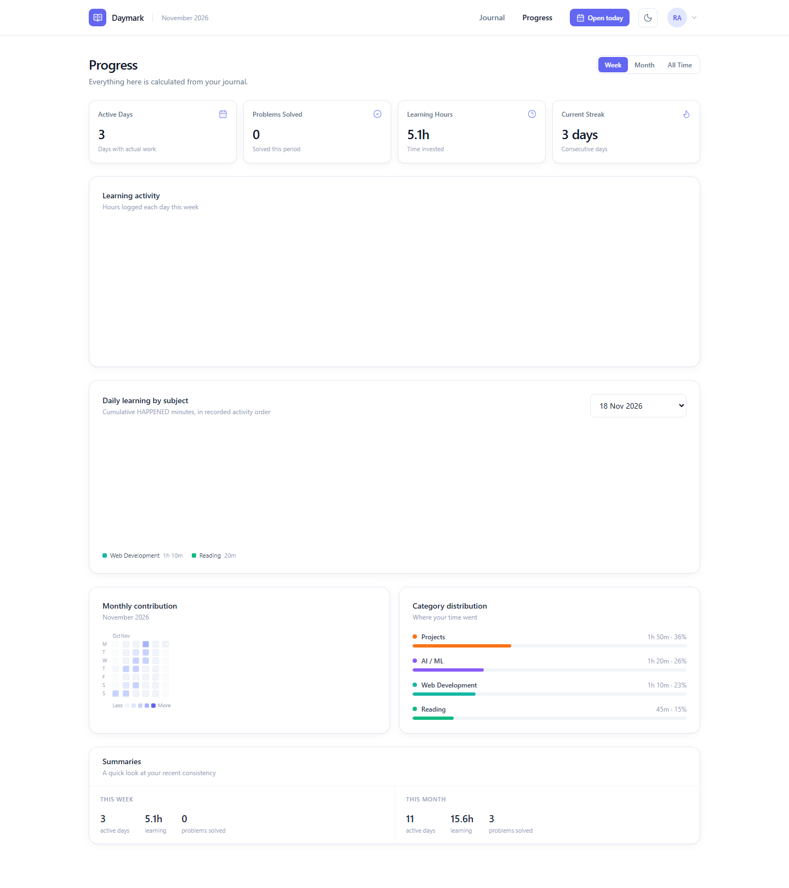
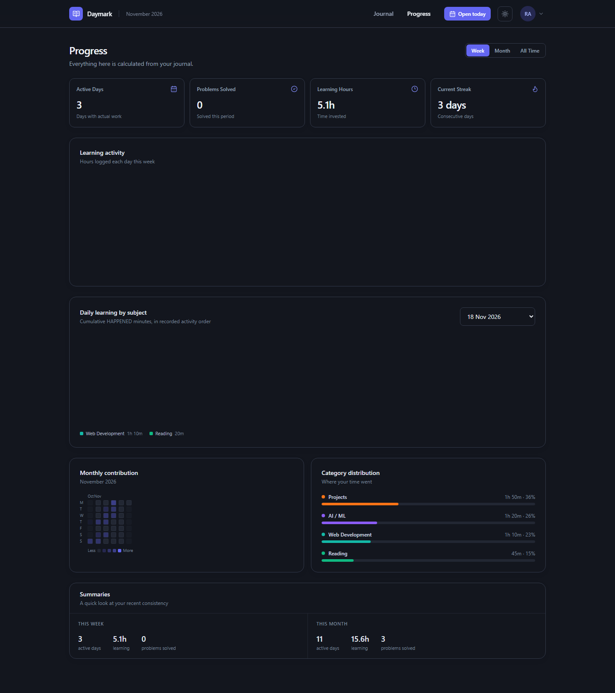
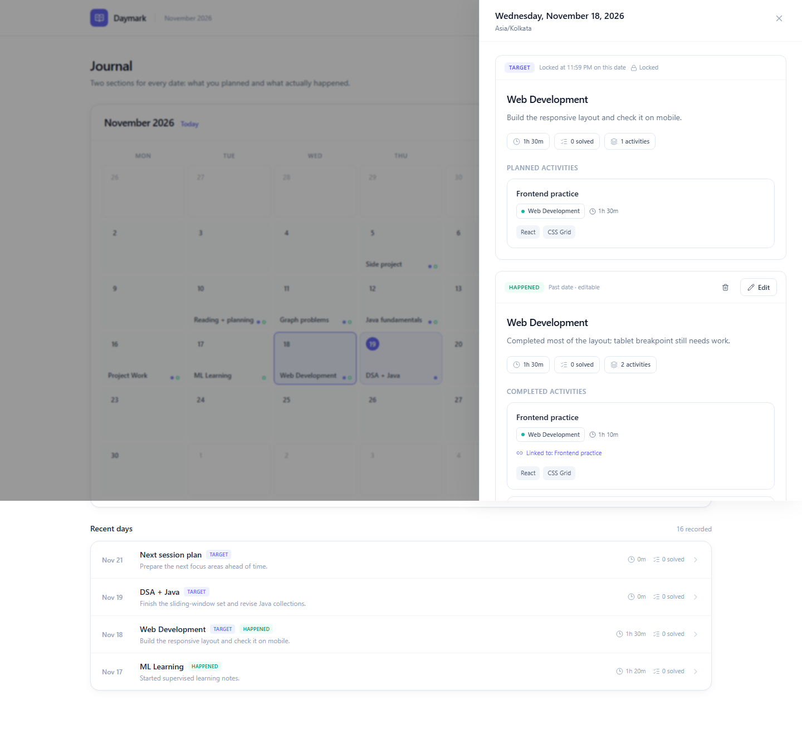

# Daymark

A calm, minimal daily journal for learning and growth. Daymark keeps **what you planned**
(TARGET) and **what actually happened** (HAPPENED) as two separate records for every date, with
timezone-aware permissions and a light/dark theme.

## Screenshots

### Journal — TARGET / HAPPENED calendar and recent days



### Progress — analytics, compact contribution heatmap and daily learning graph



### Dark mode



### Daily learning graph inside a HAPPENED entry



## Features

- **Two independent sections per day** — TARGET (planned) and HAPPENED (actual) are never mixed
  or overwritten. TARGET is editable only for today and future dates; HAPPENED unlocks at 00:00
  the following local day.
- **Timezone-aware permissions** — the authoritative date and timezone rules live in a single
  shared module and are enforced server-side by Cloud Functions when Firebase is configured.
- **Compact contribution heatmap** — a small daily activity grid with month labels and duration
  tooltips.
- **Multi-colour daily learning graph** — a smooth cumulative curve per subject built from actual
  HAPPENED durations, with a legend and tooltips. Uses recorded activity order when timestamps are
  absent; no clock times are invented and TARGET durations are never counted as completed time.
- **Light and dark themes** — instant toggle in the header, persisted across reloads with no flash
  of the wrong theme.
- **Progress analytics** — active days, problems solved, learning hours, streaks, category
  distribution and weekly activity, derived from HAPPENED records only.
- **Profile and public profile settings**, with a selectable timezone.
- **Local demo mode** — the app runs immediately with seeded demo data and no configuration.

## Tech stack

React 19, TypeScript, Vite, Tailwind CSS, Recharts, date-fns, Zod. Optional Firebase backend
(Firestore + Cloud Functions) for authenticated, server-enforced storage.

## Getting started

```bash
npm install
npm run dev
```

Open the URL printed by Vite (typically `http://localhost:5173`) and choose
**Explore with demo account**. No credentials are needed in local demo mode.

### Scripts

| Command | Description |
| --- | --- |
| `npm run dev` | Start the development server |
| `npm run build` | Type-check and build for production |
| `npm run typecheck` | Run TypeScript checks |
| `npm test` | Run the test suite |
| `npm run preview` | Serve the production build locally |

## Firebase (optional)

The app works without Firebase. To use Firestore storage and the Cloud Functions callables:

1. Copy `.env.example` to `.env` and fill in your Firebase web app config.
2. Deploy the Firestore rules in `firestore.rules` and the functions in `functions/`.
3. Client writes are denied by the rules; all writes go through authenticated callables that
   validate dates and enforce permissions using the server clock.

## Project structure

```
src/
  components/   UI (analytics, calendar, journal, layout, profile, common)
  context/      Auth, Journal and Theme providers
  pages/        Journal, Progress, Login, Register
  services/     Analytics, storage, auth and theme services
  utils/        Shared UI/date helpers
  data/         Demo seed data
shared/         Timezone/permission rules and payload schemas (used by app and functions)
functions/      Firebase Cloud Functions
tests/          Vitest regression tests
docs/screenshots/ README screenshots
```

See [DEVELOPMENT_PROGRESS.md](DEVELOPMENT_PROGRESS.md) for the detailed implementation history.
